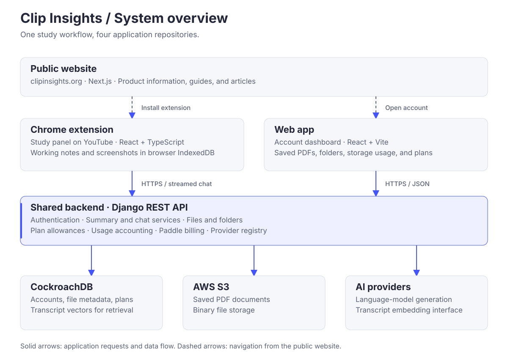
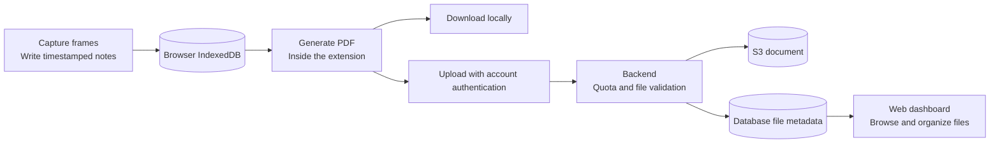

# Clip Insights architecture

Clip Insights has four application repositories. The extension provides the video study workspace; the web app provides the account and document library; both use the backend. The public website contains product information and guides.

## Components and responsibilities

| Component | Responsibility | Main code locations |
| --- | --- | --- |
| [Chrome extension](https://github.com/Clip-Insights/chrome-extension) | Video-page integration, screenshots, notes, transcript reading, AI views, PDF generation. | `src/content`, `src/platforms`, `src/features`, `src/core` |
| [Web app](https://github.com/Clip-Insights/web-app) | Sign-in, document and folder management, storage and plan usage, billing UI. | `src/pages`, `src/context`, `src/services`, `src/routes` |
| [Backend](https://github.com/Clip-Insights/backend) | Authentication, AI services, retrieval, storage access, plans, billing, analytics. | `account`, `videos`, `files`, `plans`, `billing`, `analytics`, `integrations` |
| [Public website](https://github.com/Clip-Insights/main-site) | Product homepage, guides, articles, contact and policy pages. | `app`, `components`, `content`, `lib` |

## System overview

The public Next.js website is separate from these account and AI requests. It links learners to the extension and web app.

## Video question answering

The cache key includes the video URL and embedding model identity. A model change therefore creates a separate set of vectors. The backend carries up to three recent conversation messages. If retrieval fails or returns no usable context, it uses a bounded transcript excerpt of up to 4,000 characters.

Summaries use a separate service that requests structured summary and key-point output. Retrieval is the chat path; it is not required for every summary request. The extension obtains captions through its platform adapter. Retired audio-transcription integrations are outside the supported API surface.

Implementation: [`videos/services/chat.py`](https://github.com/Clip-Insights/backend/blob/main/videos/services/chat.py), [`videos/services/chunking.py`](https://github.com/Clip-Insights/backend/blob/main/videos/services/chunking.py), and [`integrations/registry.py`](https://github.com/Clip-Insights/backend/blob/main/integrations/registry.py).

## From working notes to a saved document

Local working data and saved account documents have different lifecycles. Extension records are subject to a five-day cleanup policy on panel mount. Downloading or saving a PDF is the way to retain a study session beyond that local working period.

## Engineering choices

- **Platform adapters:** YouTube-specific DOM selection, transcript access, and navigation handling sit behind a `PlatformAdapter` interface. YouTube is the implemented platform.
- **Scoped UI:** The extension mounts React inside a Shadow DOM to isolate its styles from the host page.
- **Provider registry:** External services are selected through environment configuration. Feature services request an integration by capability rather than constructing vendor clients directly.
- **Shared account services:** JWT authentication, storage quotas, and plan allowances are handled by the backend for both clients.
- **Separate document storage:** CockroachDB holds account and file metadata; S3 holds the PDF objects.

## Running and reviewing the project

Start with the repository READMEs for environment variables and exact commands. Run the backend on port 8000, then start the web app and build the extension against it. The public site runs independently.

For a focused code review, follow a request from the extension's API client into the backend URL configuration, view, service, and integration provider. For document management, follow the dashboard's authenticated request into the backend `files` app and storage provider.

See the component guides for further detail: [extension](https://github.com/Clip-Insights/chrome-extension/blob/main/ARCHITECTURE.md), [backend](https://github.com/Clip-Insights/backend/blob/main/ARCHITECTURE.md), [web app](https://github.com/Clip-Insights/web-app/blob/main/ARCHITECTURE.md), and [public website](https://github.com/Clip-Insights/main-site/blob/main/ARCHITECTURE.md).
